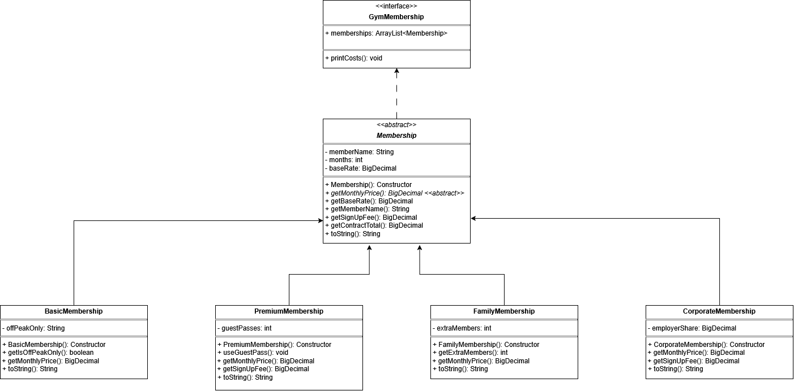

# Gym Membership App


## Description of the Project

This is a simple gym app witch keeps track of different types of memberships.

## Features

- Displays all Memberships.
- Calculates monthly revenue.
- Calculates total contract revenue.

## User Stories

- As a gym manager, I want to view all memberships and their contract totals so that I can track gym revenue.
- As a front desk employee, I want to see membership-specific notes so that I can apply the correct access rules and services for each member.
- As a gym owner, I want different membership types to calculate prices differently so that discounts and benefits are automatically applied.
## Setup

### Prerequisites

- Java 17 (Amazon Corretto), the version used in class.
- IntelliJ IDEA Community Edition: <https://www.jetbrains.com/idea/download/>

### Running the application

1. Clone this repository, or download it as a zip and unzip it.
2. In IntelliJ: File > Open, pick the project folder (the one that holds `pom.xml`), press Open.
3. Wait for IntelliJ to finish indexing (progress bar at the bottom).
4. Open `src/main/java/com/pluralsight/YourMainClassName.java`. <!-- replace YourMainClassName with the class that has main -->
5. Right-click inside the file and choose Run 'YourMainClassName.main()'.

### Data and configuration

- `class-diagram.drawio` sits at the project root, next to `pom.xml`. Contains a diagram of the app structure.

## Technologies Used

- Java 17
- IntelliJ IDEA

## App Diagram



## A piece of code I am proud of

```java
System.out.println("\n=== Front desk notes ===");
        for (Membership membership : memberships) {
        if (membership instanceof BasicMembership) {
        if (((BasicMembership) membership).getIsOffPeakOnly()) {
        System.out.println(membership.getMemberName() + ": Entry between 10:00 and 16:00 only");
        }
        }
        if (membership instanceof PremiumMembership) {
        ((PremiumMembership) membership).useGuestPass();
            }
                    if (membership instanceof FamilyMembership) {
int printedKeys = 1 + ((FamilyMembership) membership).getExtraMembers();
                System.out.println(membership.getMemberName() + ": Print " + printedKeys + " key cards");
        }
        }
```
I'm proud of my "Front Desk Notes" section because it prints different notes based on the type of membership 
and uses values that only exist in certain membership classes. 
This was my first time using instanceof, and I found it really useful for checking an object's type 
and accessing information specific to that membership. It helped me better understand how inheritance works in Java.

## Resources


- Java YearUp Fall 2026 hub: <https://raymaroun.github.io/yearup-java-fall2026/>

## Author


- **Fabricio Leonel Baliño @ https://github.com/FabricioB44**

## Thanks

- Thank you to Raymond Maroun for guiding me with Java and pushing me to better document my code!